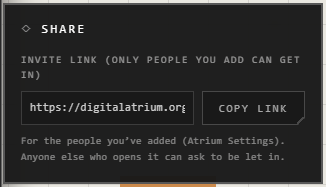

# Sharing an atrium

How you share an atrium depends on where it lives. Open it, then **Menu** >
**Share**: the panel shows only what works for that atrium.

| The atrium lives | Share it by | Who gets in |
|---|---|---|
| Online (kept by the Atrium) | Adding people, then its invite link | Those people. Anyone else can ask to be let in |
| In Google Drive | Adding people, then its invite link | Those people. Anyone else can ask to be let in |
| In this browser | **Save as .atrium**, then send the file | Whoever opens the file gets their own copy |
| On this computer (desktop) | **Save as .atrium**, then send the file | Whoever opens the file gets their own copy |

Not sure where yours lives? See [Where atriums live](../getting-started/where-atriums-live.md).

## An online or Google Drive atrium

These are encrypted, so a link alone doesn't let anyone in.

1. In **Atrium Settings** > **People**, add the person by their username, and choose their role.
2. They find the invitation under **Atriums** > **Shared with you** and can go in at once.
3. To send them straight to it, **Menu** > **Share** > **Copy link**, and paste it to them.

Anyone else who opens the link can press **Join** to ask. The owner and the
admins see the request the next time they open the atrium. Once they let
the person in, that person presses **Join** again.

If someone's invitation doesn't open, it may be from before invitations could
open an atrium by themselves. Send it again: **Atrium Settings** > **People** >
**Resend invitation**, beside their name.

## A browser or desktop atrium

These live on one device, so no link can reach them. **Menu** > **Share** >
**Save as .atrium** makes a file you can send. It opens in the app or on the
web, as the other person's own copy: changes on either side don't reach the other.

To work on it together, move it online or into Google Drive first. See
[Moving atriums](../keeping-and-moving/moving-atriums.md).

## Good to know

- A browser atrium and a desktop atrium can't be linked: no one else can reach them live.
- An .atrium file is a copy, not a shared atrium.
- The invite link lets in only the people you've added; anyone else has to ask.
- What each person can do once they're in (owner, admin, editor, viewer) is set by their role.

## Related

- [Where atriums live](../getting-started/where-atriums-live.md): the kinds of atrium, and why that decides how you share.
- [People and roles](people-and-roles.md): who can edit, and the blocked list.
- [Public atriums](public-atriums.md): listing an atrium for anyone to find, rather than sending it.
- [Drive atriums](drive-atriums.md): members, asking to join, and bringing back deleted traces.
- [Export](../keeping-and-moving/export.md) and [Import](../keeping-and-moving/import.md): the .atrium file in detail.
- [Moving atriums](../keeping-and-moving/moving-atriums.md): putting a browser or desktop atrium online so it can be shared.
